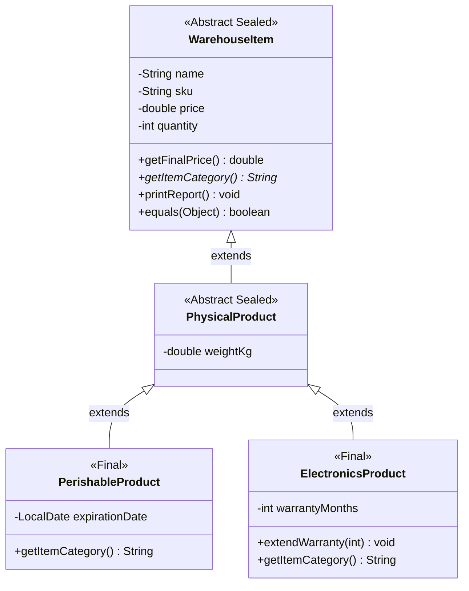

# Warehouse Accounting
A modular Java-based command-line application designed for warehouse inventory management and tracking. Developed as part of a structured academic project series.

## Features
- **Product Entity Management**: Tracks core product attributes including unique SKU, name, category, quantity, price, weight, and stock availability status.
- **Automated Calculations**: Computes total stock value and aggregate physical weight dynamically.
- **Conditional Stock Status**: Categorizes inventory levels using conditional branching logic.
- **Formatted Reporting**: Outputs clean, structured product summaries using localized console formatting.

# Lab 2: Processing Arrays Using Loops

**Domain:** Warehouse accounting

## Description
The project implements a console application for managing an array of products (`Product`). 
The program allows you to:
1. Enter product data from the keyboard and store it in an array of objects.
2. Display the list of products using the overridden `toString()` method.
3. Count the number of products that meet a certain condition (e.g., price higher than a given value).
4. Sort the array of objects by price using the **Bubble Sort** algorithm.
5. Perform a linear search for a specific reference object in the array using the overridden `equals()` method.

# Lab 3: Exception Handling and Custom Exceptions

**Domain:** Warehouse accounting

## Description
This project implements robust exception handling for a warehouse accounting application. It demonstrates the use of standard and custom exceptions to validate domain rules and handle unexpected runtime errors.

**Key Features:**
1. **Standard Exception Handling:** Uses `try-catch-finally` to safely handle `InputMismatchException` (invalid user input types) and `ArrayIndexOutOfBoundsException` (accessing invalid product indices).
2. **Custom Exception Hierarchy:** Implements a base `WarehouseException` (checked exception) with two subclasses: `InvalidPriceException` and `InvalidQuantityException`. Each custom exception carries additional context (the rejected value).
3. **Advanced Flow Control:** Demonstrates multiple `catch` blocks ordered from specific to general, exception re-throwing (logging errors before passing them up the call stack), and guaranteed resource cleanup using the `finally` block to close the `Scanner`.

# Lab 4: Interfaces, Polymorphism, and Strategy Pattern

**Domain:** Warehouse accounting

## Description
This project demonstrates advanced Object-Oriented Programming principles in Java, focusing on dynamic behavior modification using interfaces and the **Strategy Pattern**. 

**Key Features:**
1. **Interfaces & Polymorphism:** Defines a `PricingStrategy` interface. An array of products delegates price calculation to various strategy implementations transparently.
2. **Default Methods:** The interface includes a `default getStrategyName()` method to avoid duplicating basic behavior across all implementations.
3. **Abstract Classes:** A `DiscountPricingStrategy` abstract class provides shared discount calculation logic, adhering to the DRY (Don't Repeat Yourself) principle.
4. **Multiple Interfaces:** The `Product` class implements both `Reportable` (business behavior) and `Comparable` (sorting behavior) simultaneously.
5. **Strategy Pattern:** The `Product` context class accepts a `PricingStrategy` via its constructor and a setter. This allows the system to change pricing rules (e.g., applying a Black Friday discount) dynamically at runtime without recreating the objects.

## Lab 5: Code Refactoring with Design Patterns (GoF)

**Domain:** Warehouse accounting  
**Description:**  
This project focuses on refactoring the existing codebase by incorporating Gang of Four (GoF) design patterns—Factory Method, Observer, and Adapter. The refactoring addresses real architectural issues, improving code maintainability, extensibility, and loose coupling without modifying core domain logic.

**Key Features:**
1. **Factory Method Pattern (Creational):** Encapsulates the instantiation logic of pricing strategies inside a `PricingStrategyFactory`. Replaces direct `new` calls and conditional creation logic in client code, strictly adhering to the Open/Closed Principle (OCP).
2. **Observer Pattern (Behavioral):** Decouples inventory state changes from notification mechanisms. The `Product` class acts as a subject (`InventorySubject`) that notifies registered `StockObserver` implementations (such as `AuditLogger` for activity tracking and `LowStockNotifier` for inventory threshold alerts) whenever product quantities change.
3. **Adapter Pattern (Structural):** Integrates an incompatible legacy third-party API (`ExternalSupplierApi`) into the existing domain infrastructure. The `LegacySupplierAdapter` converts wholesale cost calculations (provided in cents) to match the internal `PricingStrategy` interface without altering the external library's source code.

# Lab 6: Class Hierarchy and Inheritance (Sealed Classes & Pattern Matching)

**Domain:** Warehouse accounting

## Description
This project focuses on refactoring the domain model by establishing a strict class hierarchy based on Object-Oriented Programming inheritance principles ("is-a" relationship). It transitions the flat `Product` model into a multi-level closed hierarchy using modern Java 21+ features such as Sealed Classes, Pattern Matching, and safe equality guarantees.

**Key Features:**
1. **Multi-Level Sealed Inheritance Hierarchy:** Replaces the single `Product` class with a 3-tier sealed class structure:
   - `WarehouseItem` (Abstract Sealed Base): Holds core identity (`name`, `sku`, `price`, `quantity`) and enforces polymorphism.
   - `PhysicalProduct` (Abstract Sealed Intermediate): Extends `WarehouseItem` to add physical specifications (`weightKg`).
   - `PerishableProduct` & `ElectronicsProduct` (Final Leaf Subclasses): Implement specialized domain attributes such as `expirationDate` and `warrantyMonths`.

2. **Constructor Delegation & Chaining:** Demonstrates the explicit call sequence across class levels using `super(...)` for parent initialization and overloaded constructors with `this(...)` to minimize boilerplate.

3. **Polymorphic Reporting & Behavior:** Overrides domain reporting and string representations (`toString()`). A single polymorphic array of `WarehouseItem` objects executes dynamic method dispatch seamlessly during iteration.

4. **Exhaustive Pattern Matching & Switch:** Utilizes Java 21 `switch` expressions over sealed types to perform safe type casting and invoke subclass-specific methods (e.g., `extendWarranty()`) without unhandled runtime cases or fallback `default` blocks.

5. **Symmetric Equality (`equals` & `hashCode`):** Implements strict type checking via `getClass()` instead of `instanceof` across all hierarchy levels to prevent symmetry violations when comparing base and extended objects.

6. **Inheritance vs. Composition Trade-Offs:** Retains composition for runtime behaviors (`PricingStrategy` and `InventorySubject`) where a "has-a" relationship applies, avoiding tight coupling and violation of the Single Responsibility Principle.

---

## Class Diagram

## How to launch:
Download file from github

	git clone https://github.com/mXd-mXn/warehouse-accounting.git

Compile code

	javac Main.java
	
Launch file

	java Main
